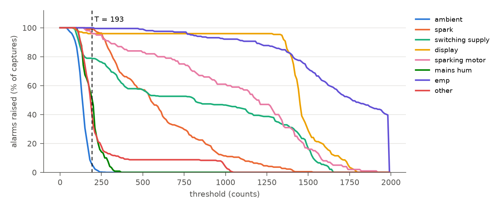
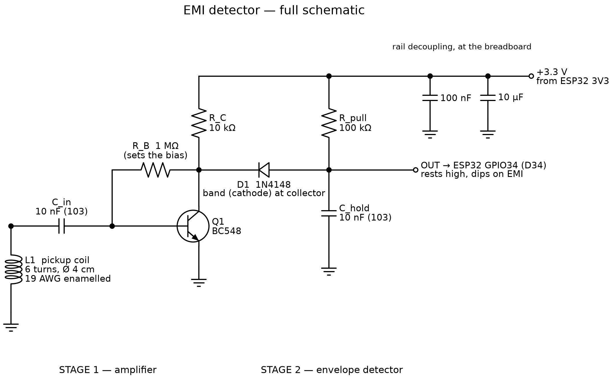

# EMISense

**Working out which kind of source made a burst of electromagnetic
interference (EMI), on a microcontroller, so that everyday appliances stop
setting off sensor-attack alarms.**

A common way to guard an analog sensor against EMI attacks is to place a
pickup coil beside it and sound an alarm whenever the coil's signal rises
above a set level. Phone chargers, motors, displays and lighter sparks give
signals of a similar size, and a single level mixes up how strong a source is
with how close it is, so such a detector fires on household devices as readily
as on an attacker. EMISense keeps the inexpensive coil and BC548 transistor,
adds an envelope detector after them, samples the envelope 20,000 times a
second on an ESP32, and lets a small 8-bit neural network on the ESP32 itself
decide what produced each 100 ms burst.

This repository contains:

- **the dataset**: 2,295 labelled 100 ms captures of 26 household sources and
  an EMI attack emitter, recorded in eleven places in three homes;
- **the firmware**: acquisition (`emi_capture`) and on-device classification
  (`emi_classify`) for the ESP32;
- **the analysis and training code** that produces every number below;
- **the hardware description**: circuit, parts and breadboard layout;
- **a live web dashboard** that shows what the detector sees and decides.

<p align="center">
  
</p>
<p align="center"><em>An amplitude threshold set from ambient readings (dashed
line) alarms on almost every benign source; any threshold high enough to
silence them also misses much of the attack ("emp").</em></p>

## Results

Classifier scores are those of the int8 model that runs on the board, as the
mean over five seeds, with whole recording blocks held out of training. All
numbers come from [`analysis/`](analysis) and are reproduced by the scripts
below.

| Detector | Attack detected | False alarms, benign sources | False alarms, ambient |
|---|---|---|---|
| Amplitude threshold, T = 193 counts (95th percentile of ambient) | 100% | 84.7% | 5.1% |
| Amplitude threshold raised to T = 1601 counts | 62.7% | 5.7% | 0.0% |
| **EMISense classifier** | **92.4%** | **5.8%** | **0.2%** |

- **Naming the source:** the right one of seven classes (the attack is one of
  them) for 87.6% of captures from recording blocks left out of training;
  77.5% when a whole room is left out, and 66.8% when a device model is.
- **Attacks in unfamiliar conditions:** trained without one of the three
  distances, it still flags 88.8% of the attack captures at that distance. It
  flags 91.9% of the captures from the emitter after its coil lead was
  reconnected, a condition it never saw during training.
- **Attribution:** of the benign captures the threshold alarms on, 84.1% are
  given their actual source class.
- **On the ESP32:** one decision, features plus network, needs a median of
  9.7 ms, and only 60 µs of that is the neural network. Compared with the
  capture-only firmware, the classifier costs 6.4 KB more flash and 5.1 KB
  more RAM. Replaying 255 stored captures to the board gives the same
  features and the same class as the Python code every time.

## Repository layout

| Path | Contents |
|---|---|
| [`data/`](data) | the 2,295 captures, one CSV each ([format](docs/DATASET.md#each-capture)) |
| [`metadata.csv`](metadata.csv) | one row per capture: label, class, device, distance, place, time, block |
| [`docs/DATASET.md`](docs/DATASET.md) | classes, devices, collection protocol, caveats |
| [`docs/HARDWARE.md`](docs/HARDWARE.md) | circuit, parts list, breadboard wiring, coil |
| `capture.py` | records labelled captures from the board over USB serial |
| `dataset.py`, `features.py` | loading, class mapping, the 15 features |
| `analyze.py` | the amplitude-threshold baseline and its sweep |
| `train.py` | trains, evaluates and quantizes the classifier; writes `emi_classify/emi_model.h` |
| `attribution.py` | which threshold alarms the classifier attributes to their source |
| `verify_board.py` | replays stored captures to the board and compares with Python |
| `emi_capture/` | ESP32 acquisition firmware (used to record the dataset) |
| `emi_classify/` | ESP32 firmware with on-device features and classifier |
| `dashboard/` | live web dashboard (Web Serial) with a demo mode |
| [`analysis/`](analysis) | results: summaries, JSON and figures |

## The dataset

| Class | Sources | Devices | Captures |
|---|---|---|---|
| ambient | the room with no deliberate source | — | 843 |
| spark | piezo lighters and igniters | 3 | 219 |
| switching_supply | phone chargers, a router adapter | 7 | 380 |
| display | phone screens, coil on the glass | 3 | 174 |
| sparking_motor | mixer-grinders with commutator sparking | 2 | 100 |
| mains_hum | games console, TV, mixer-grinder, air fryer | 4 | 120 |
| emp | EMI attack emitter at 1, 3 and 5 cm | 1 | 204 |
| *not classifier targets* | weak or single-of-their-kind sources, the damaged emitter | 9 | 255 |

Each capture is 2,000 readings of the 12-bit ADC at 20 kSa/s (100 ms). The
front end inverts, so the output rests near 2,000 counts and interference
pulls it down. Events (sparks, the emitter) were captured in triggered mode,
aligned at sample 400; continuous sources and ambient in free-running mode.
Every capture records its source, device, distance, place and time, so that
evaluation can hold out whole recording blocks, places or device models.
[`docs/DATASET.md`](docs/DATASET.md) describes the format, every device and
the collection protocol.

## Hardware

<p align="center"></p>

A six-turn, 4 cm coil feeds a BC548 common-emitter stage through a 10 nF
capacitor; a 1N4148 diode, 10 nF and 100 kΩ form an envelope detector with a
1 ms memory, read by GPIO34 of an ESP32 DevKit V1. Everything sits on a
solderless breadboard and runs from the ESP32's 3.3 V. Parts, values and the
hole-by-hole wiring are in [`docs/HARDWARE.md`](docs/HARDWARE.md).

The attack emitter at 1 cm, and again at 3 cm, destroyed the front-end
transistor when its battery was fully charged. Detectors with a similar
unprotected transistor input may face a comparable risk; see the hardware
notes.

## Reproducing the results

Python 3.10 or later:

```bash
pip install -r requirements.txt
python analyze.py       # threshold baseline, about a minute: analysis/summary.md and figures
python train.py         # classifier, five seeds, about an hour: analysis/train_summary.md, results.json
python attribution.py   # attribution of threshold alarms: analysis/attribution.json
```

`python train.py --seeds 1` gives a quick single-seed run. `train.py` also
rewrites `emi_classify/emi_model.h`, the weights the firmware is compiled with.

## Firmware

Both sketches build with the Arduino ESP32 core 3.3.11 for the
`esp32:esp32:esp32doit-devkit-v1` board, for example with `arduino-cli`:

```bash
arduino-cli compile --fqbn esp32:esp32:esp32doit-devkit-v1 emi_classify
arduino-cli upload -p COM5 --fqbn esp32:esp32:esp32doit-devkit-v1 emi_classify
```

- `emi_capture` records the dataset. `python capture.py <label> --n 20`
  takes free-running captures, `--trigger 150` waits for an event; see
  `python capture.py --help`.
- `emi_classify` adds the features and the classifier. `python verify_board.py`
  replays stored captures to it and writes `analysis/board_check.md`.

Copy `config.example.ini` to `config.local.ini` and set your serial port.

## Live dashboard

```bash
python dashboard/serve.py
```

opens `http://127.0.0.1:8000/dashboard/` (served to this computer only). In
Chrome or Edge, **Connect detector** reads the board running `emi_classify`
over USB and shows each 100 ms window: the waveform, the board's decision and
confidence, the amplitude threshold's verdict beside it, and the latency on
the device. **Demo** replays stored captures without a board.

## Citation

If you use the dataset or the code, please cite it using
[`CITATION.cff`](CITATION.cff) ("Cite this repository" on GitHub). A paper
describing this work is in preparation.

## License

Code and firmware: [MIT](LICENSE). Dataset (`data/` and `metadata.csv`):
[CC BY 4.0](data/LICENSE).

## Authors

G. Harshith Sai, Nissi Praharsha C., D. Manogyna and P. Sathvika, students
of computer science and engineering at SRM University-AP, and Raushan Kumar
Singh.

Developed in the course CSE 469 Edge Computing at SRM University-AP.

## Acknowledgments

We thank the households that hosted the recording sessions. The attack
emitter is the one used to evaluate SecureTrack (R. K. Singh and S. Mishra,
*IEEE Sensors Journal* 25(5), 2025).

## Safety

The dataset includes recordings of an EMI attack emitter, made following
the instructions of the emitter's owner. This repository contains no design for an
emitter. Deliberately radiating interference is regulated in most countries
(in India by the Wireless Planning and Coordination Wing).
