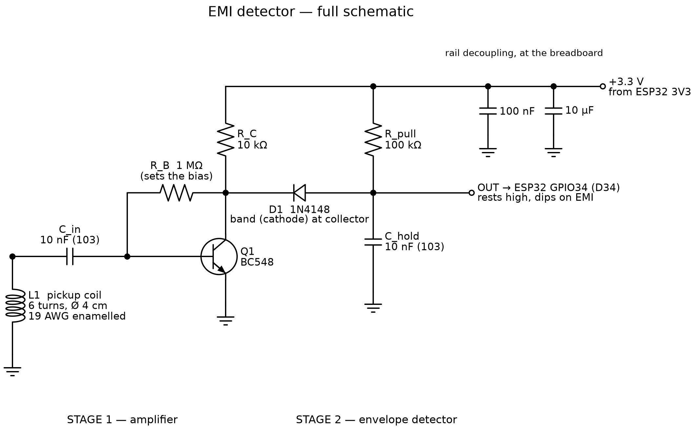
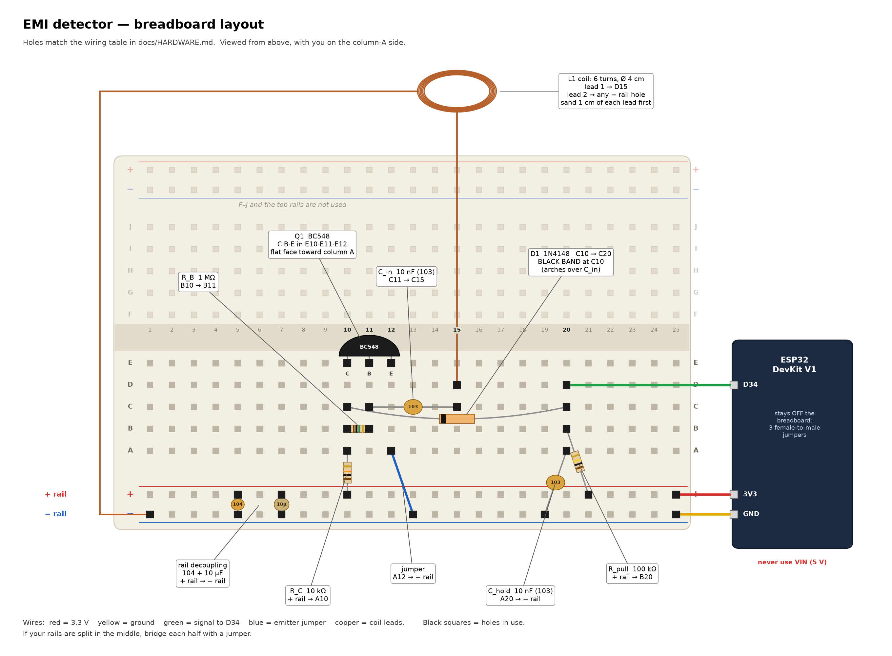
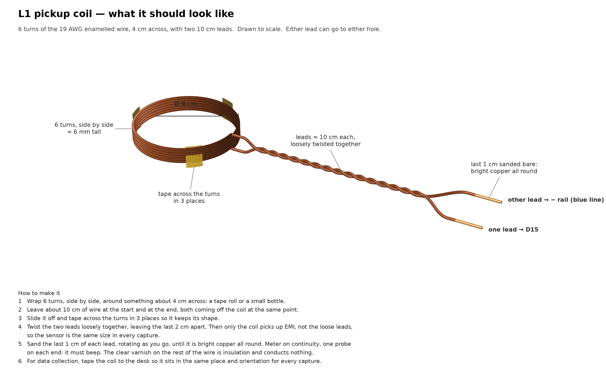

# EMISense hardware

```
coil -> coupling capacitor -> BC548 amplifier -> envelope detector -> ESP32 ADC (GPIO34)
```

<p align="center"></p>

## Parts

| Part | Value | Qty |
|---|---|---|
| ESP32 DevKit V1 (ESP32-WROOM-32, CP2102 USB) | — | 1 |
| NPN transistor | BC548 (BC547 also works) | 1 |
| Diode | 1N4148 | 1 |
| Capacitor, ceramic | 10 nF (`103`) | 2 |
| Resistor | 1 MΩ | 1 |
| Resistor | 10 kΩ | 1 |
| Resistor | 100 kΩ | 1 |
| Rail decoupling capacitors | 100 nF (`104`) and 10 µF | 1 each |
| Enamelled copper wire | 19 AWG (1.0 mm), about 1 m | 1 |
| Solderless breadboard, 830 points | — | 1 |
| Jumper wires (three female-to-male for the ESP32) | — | ~6 |
| USB data cable for the ESP32 | — | 1 |
| Multimeter (for the checks below) | — | 1 |

No soldering is needed.

## Circuit

**Amplifier**

| Part | Connection |
|---|---|
| Coil, 6 turns of 19 AWG, about 4 cm diameter, leads twisted together | one end to ground, the other to C_in |
| C_in, 10 nF | coil to the BC548 base |
| R_B, 1 MΩ | collector to base (self-bias) |
| R_C, 10 kΩ | +3.3 V to collector |
| BC548 emitter | ground |

**Envelope detector**

| Part | Connection |
|---|---|
| D1, 1N4148 | band (cathode) at the collector, other end to OUT |
| C_hold, 10 nF | OUT to ground |
| R_pull, 100 kΩ | +3.3 V to OUT |
| Wire | OUT to ESP32 GPIO34 |

The whole circuit runs from the ESP32's 3V3 pin.

## Breadboard wiring

Rows are numbered, columns lettered; the left rail pair is + (red) and −
(blue). Hold the BC548 with its flat face toward you and legs down: the legs
are collector, base, emitter from left to right.

| # | Part | From | To |
|---|---|---|---|
| 1 | BC548 collector | E10 | — |
| 2 | BC548 base | E11 | — |
| 3 | BC548 emitter | E12 | — |
| 4 | Jumper | A12 | − rail |
| 5 | 10 kΩ (R_C) | + rail | A10 |
| 6 | 1 MΩ (R_B) | B10 | B11 |
| 7 | 10 nF (C_in) | C11 | C15 |
| 8 | Coil lead 1 | D15 | — |
| 9 | Coil lead 2 | − rail | — |
| 10 | 1N4148, band at C10 | C10 | C20 |
| 11 | 10 nF (C_hold) | A20 | − rail |
| 12 | 100 kΩ (R_pull) | + rail | B20 |
| 13 | Jumper | D20 | ESP32 GPIO34 |
| 14 | Jumper | ESP32 3V3 | + rail |
| 15 | Jumper | ESP32 GND | − rail |
| 16 | 100 nF (`104`), rail decoupling | + rail | − rail |
| 17 | 10 µF, rail decoupling (longer leg to +) | + rail | − rail |

<p align="center"></p>

The coil: wind six turns of the enamelled wire round a 4 cm former, tape it in
three places, twist the two leads together along their length, and sand the
enamel off the last centimetre of each lead.

<p align="center"></p>

`python docs/make_diagrams.py` regenerates these drawings (needs `schemdraw`).

## How it works

- **Self-bias.** R_B from collector to base holds the collector near the
  middle of the supply whatever the transistor's gain: 0.9–2.0 V depending on
  the part. Three BC548s measured 1.30–1.38 V at the collector and
  0.50–0.59 V at the base.
- **AC coupling.** A coil is nearly a short at DC; C_in keeps it from pulling
  the base to ground.
- **The output is inverted.** A common-emitter stage pulls the collector down
  on a positive input; the diode, facing "backwards", lets C_hold follow the
  collector down and R_pull recharge it. The output rests near 1,950–2,075
  counts and dips on interference.
- **Envelope memory.** R_pull × C_hold = 1 ms. The radio-frequency waveform
  itself is far beyond any microcontroller's sampling rate; the envelope keeps
  its timing. Because C_hold recharges toward the 3.3 V rail, a deep spark
  recovers at about 130 counts per sample, within about 0.35 ms.
- **Sampling.** GPIO34 (ADC1, input only), 12 bits, 11 dB attenuation, one
  reading every 50 µs: 2,000 readings make a 100 ms window. The measured
  window length is 99,991 µs.

## Checks

| Check | Expected |
|---|---|
| Supply, + rail to − rail | 3.3 V ± 0.1 |
| Collector (R_B's leg in row 10) | 0.9–2.0 V |
| Base (R_B's leg in row 11) | about 0.5–0.6 V |
| Resting output, nothing near the coil | about 1,950–2,075 counts, varying by a few tens |
| A phone display (always-on) face-down on the coil | bursts reaching near the floor (about 500–600 counts) |

A normal resting level alone does not prove the circuit works: a loose coil
lead leaves it unchanged while removing the response. Check against a known
source after every move.

## Warnings

- **The attack can destroy this front end.** The emitter used for the attack
  recordings, on a fully charged battery, destroyed the BC548 at 1 cm and a
  fresh one at 3 cm: the base read 0 V afterwards. Each time, the resting
  level crept upward before the transistor gave out. Detectors with a similar unprotected
  transistor input may face a comparable risk. An input clamp before the
  transistor is the obvious protection (not tested here), and a drifting
  resting level is an early warning.
- **ESP32 inputs are not 5 V tolerant.** If you connect a detector whose output
  swings to 5 V, use a 10 kΩ / 15 kΩ divider and a shared ground.
- Pins 34–39 have no internal pull resistors: a bare GPIO34 holds whatever
  charge it last saw, which can look like a dead pin.
